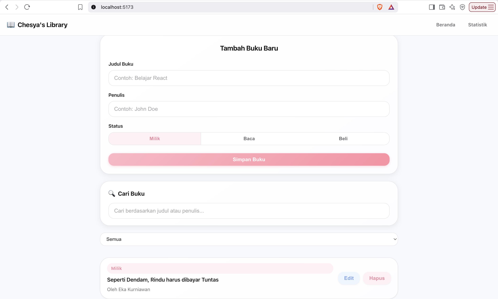
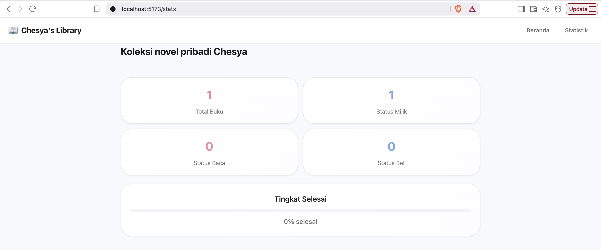
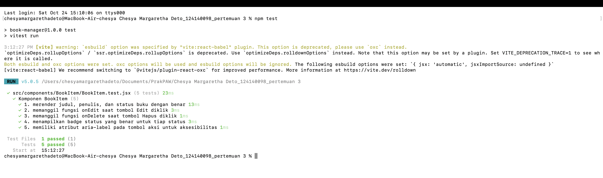

# Aplikasi Manajemen Buku Pribadi

Aplikasi **Manajemen Buku Pribadi** berbasis web yang dibangun dengan **React** untuk membantu pencatatan buku-buku yang dimiliki, sedang dibaca, atau ingin dibeli.

> **Identitas Mahasiswa:**  
> Nama: **Chesya Margaretha Deto**  
> NIM: **124140098**  
> Kelas: **Praktikum PAW RB**  
> Mata Kuliah: **Praktikum Pengembangan Aplikasi Web (Pertemuan 3)**

---

## Deskripsi Aplikasi

Aplikasi ini memungkinkan pengguna mencatat koleksi buku pribadi dengan status milik, baca, atau beli. Pengguna dapat menambah, mengedit, dan menghapus buku, serta mencari dan memfilter buku berdasarkan status. Data disimpan secara lokal di browser sehingga tetap tersedia setelah halaman dimuat ulang.

### Fitur Utama

1. **Manajemen Buku (CRUD):**
   - **Tambah:** Simpan judul, penulis, dan status buku melalui formulir.
   - **Tampilkan & Saring:** Lihat daftar buku dalam satu tampilan. Filter berdasarkan status `Semua`, `Milik`, `Baca`, atau `Beli`.
   - **Sunting & Hapus:** Ubah data buku melalui formulir edit dan hapus melalui konfirmasi dialog.
   - **Cari:** Cari buku berdasarkan judul atau nama penulis.

2. **Penyimpanan Lokal Persisten (`localStorage`):** Data buku disimpan di `localStorage` dan dipertahankan saat halaman dimuat ulang.

3. **Navigasi Multi-Halaman:** Aplikasi memiliki halaman Beranda dan Statistik tanpa perlu memuat ulang halaman secara penuh.

4. **Halaman Statistik:** Menampilkan ringkasan koleksi buku (total, status milik, status baca, status beli) serta tingkat selesai dalam bentuk progress bar.

## Screenshot Antarmuka

### Halaman Beranda



### Halaman Statistik



### Hasil Pengujian Unit Test



## Fitur React yang Diimplementasikan

| No. | Fitur React | File Sumber | Implementasi |
|:--:|---|---|---|
| 1 | Functional Components | Semua file `.jsx` | Komponen ditulis sebagai fungsi JavaScript. |
| 2 | Hooks (`useState`, `useEffect`) | `Home.jsx`, `BookContext.jsx` | Mengelola state dan siklus hidup komponen. |
| 3 | Custom Hooks | `hooks/useLocalStorage.js`, `hooks/useBookStats.js` | Memisahkan logika penyimpanan dan statistik agar reusable. |
| 4 | Context API | `context/BookContext.jsx` | State global buku yang bisa diakses seluruh komponen tanpa prop drilling. |
| 5 | React Router DOM | `App.jsx` | Navigasi SPA antara halaman Beranda dan Statistik. |
| 6 | Conditional Rendering | `Home.jsx` | Menampilkan form edit atau daftar buku berdasarkan state. |
| 7 | List Rendering dengan `key` | `BookList.jsx`, `BookItem.jsx` | Render daftar buku dengan atribut `key` yang unik. |
| 8 | Form Controlled Component | `BookForm.jsx` | Input form dikontrol oleh state React. |
| 9 | PropTypes | Semua komponen | Type checking untuk props pada setiap komponen. |
| 10 | Unit Testing (Vitest + RTL) | `BookItem.test.jsx` | Menguji render, klik tombol, dan callback dengan React Testing Library. |

## Struktur Berkas Proyek

```text
.
├── index.html
├── package.json
├── vite.config.js
├── .gitignore
├── README.md
├── dist/
├── node_modules/
└── src/
    ├── main.jsx
    ├── index.css
    ├── App.jsx
    ├── App.css
    ├── context/
    │   └── BookContext.jsx
    ├── hooks/
    │   ├── useLocalStorage.js
    │   └── useBookStats.js
    ├── components/
    │   ├── Navbar/
    │   ├── BookForm/
    │   ├── BookItem/ (termasuk BookItem.test.jsx)
    │   ├── BookList/
    │   ├── BookFilter/
    │   └── NotFound/
    └── pages/
        ├── Home/
        └── Stats/
```

## Cara Menjalankan Aplikasi

1. Masuk ke folder project di terminal VS Code:

```bash
cd Chesya\ Margaretha\ Deto_124140098_pertemuan\ 3
```

2. Install dependensi:

```bash
npm install
```

3. Jalankan development server:

```bash
npm run dev
```

Buka URL yang ditampilkan (biasanya `http://localhost:5174`) di browser.

4. Jalankan unit test:

```bash
npm test
```

5. Build untuk produksi:

```bash
npm run build
```

## Teknologi yang Digunakan

| Teknologi | Versi |
|:---|:---|
| React | 18.x |
| Vite | 8.x |
| React Router DOM | 7.x |
| PropTypes | 15.x |
| Vitest | 5.x |
| React Testing Library | 16.x |

## Hasil Pengujian

Pengujian unit menggunakan React Testing Library dan Vitest dilakukan pada komponen `BookItem` dengan 5 skenario:

1. Merender judul, penulis, dan status buku dengan benar.
2. Memanggil fungsi `onEdit` saat tombol Edit diklik.
3. Memanggil fungsi `onDelete` saat tombol Hapus diklik.
4. Menampilkan badge status yang benar untuk tiap status (Milik, Baca, Beli).
5. Memiliki atribut `aria-label` pada tombol aksi untuk aksesibilitas.

Hasil pengujian: **5 dari 5 tes lulus**.
