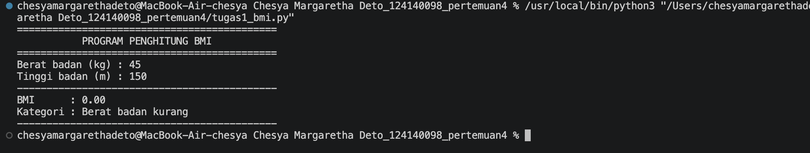
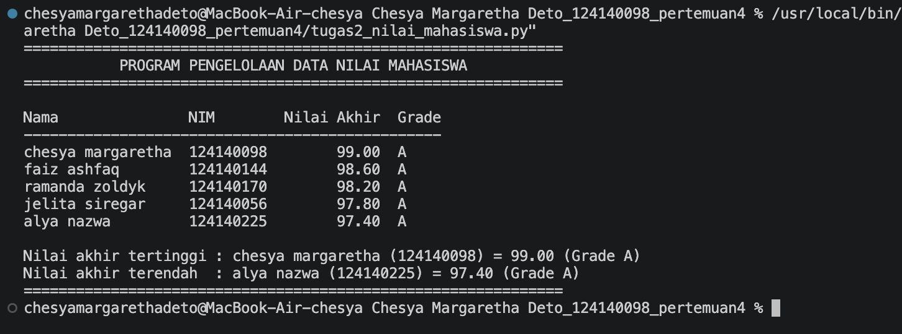
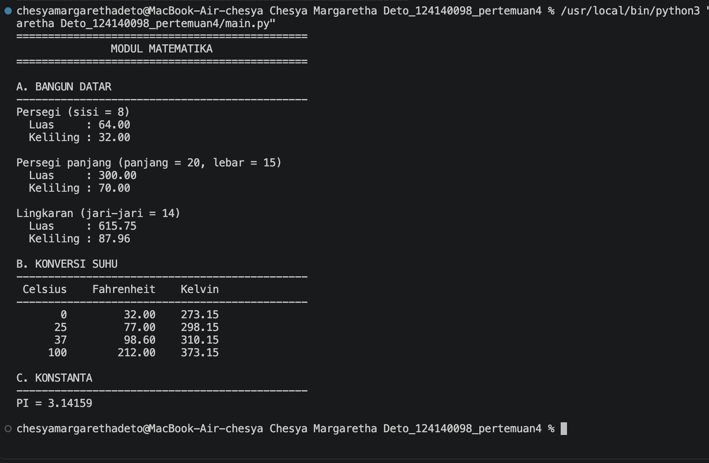

# Tugas Praktikum 4 — Dasar Pemrograman Python

## Identitas

- **Nama:** Chesya Margaretha Deto
- **NIM:** 124140098
- **Kelas:** RB

## Deskripsi Program

### Soal 1 — Program Penghitung BMI (`tugas1_bmi.py`)

Program meminta berat badan (kg) dan tinggi badan (m), lalu menghitung
`BMI = berat / (tinggi * tinggi)`. Hasil BMI ditampilkan dengan dua angka
desimal menggunakan f-string, diikuti kategori status berat badan melalui
percabangan `if-elif-else`:

- `BMI < 18.5` — Berat badan kurang
- `18.5 ≤ BMI < 25` — Berat badan normal
- `25 ≤ BMI < 30` — Berat badan berlebih
- `BMI ≥ 30` — Obesitas

### Soal 2 — Data Nilai Mahasiswa (`tugas2_nilai_mahasiswa.py`)

Data disimpan dalam list berisi lima dictionary dengan kunci `nama`, `nim`,
`nilai_uts`, `nilai_uas`, dan `nilai_tugas`. Nilai akhir dihitung dengan
bobot:

```text
Nilai Akhir = (30% × UTS) + (40% × UAS) + (30% × Tugas)
```

Grade ditentukan dengan ketentuan A (`≥ 80`), B (`70–79`), C (`60–69`),
D (`50–59`), dan E (`< 50`). Program menampilkan tabel Nama, NIM, Nilai Akhir,
dan Grade, lalu menampilkan mahasiswa dengan nilai akhir tertinggi dan
terendah.

### Soal 3 — Modul Matematika (`math_operations.py` dan `main.py`)

`math_operations.py` berisi konstanta `PI`, fungsi luas dan keliling persegi,
persegi panjang, serta lingkaran, juga fungsi konversi Celsius ke Fahrenheit
dan Celsius ke Kelvin.

`main.py` mengimpor modul tersebut dengan dua cara:

```python
import math_operations as modul
from math_operations import PI, celsius_ke_fahrenheit, celsius_ke_kelvin
```

Seluruh fungsi modul dipanggil dengan nilai pengujian dan hasilnya
ditampilkan dalam tabel.

## Struktur Folder

```text
Chesya Margaretha Deto_124140098_pertemuan4/
├── .gitignore
├── README.md
├── tugas1_bmi.py
├── tugas2_nilai_mahasiswa.py
├── math_operations.py
├── main.py
└── screenshots/
    ├── 01-tugas1-bmi.png
    ├── 02-tugas2-nilai.png
    └── 03-tugas3-matematika.png
```

## Cara Menjalankan

Prasyarat: Python 3.8 atau lebih baru

```bash
# Soal 1
python tugas1_bmi.py

# Soal 2
python tugas2_nilai_mahasiswa.py

# Soal 3
python main.py
```

Jika perintah `python` tidak tersedia, gunakan `python3`

## Screenshot Hasil

### Soal 1 — Program Penghitung BMI



### Soal 2 — Data Nilai Mahasiswa



### Soal 3 — Modul Matematika



## Catatan

- Kode menggunakan indentasi 4 spasi dan penamaan `snake_case` sesuai PEP 8.
- `venv/` dan `__pycache__/` diabaikan melalui `.gitignore`.
