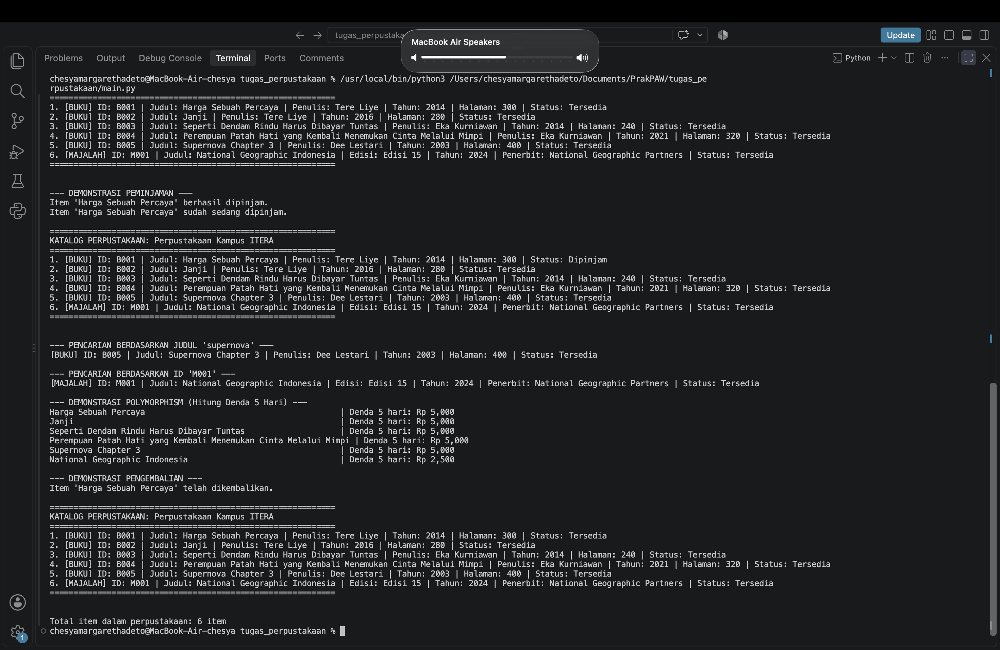

# Sistem Manajemen Perpustakaan Sederhana

## Identitas Mahasiswa
- **Nama Lengkap:** Chesya Margaretha Deto
- **NIM:** 124140098
- **Kelas Praktikum:** RB

## Deskripsi Program
Program ini adalah sistem manajemen perpustakaan sederhana yang dibangun menggunakan konsep Pemrograman Berorientasi Objek (OOP) dalam Python. Program memungkinkan pengelolaan koleksi item perpustakaan (buku dan majalah) dengan fitur penambahan item, pencarian, dan penampilan katalog.

### Penerapan 4 Pilar OOP

| Pilar OOP | Implementasi dalam Program |
|-----------|---------------------------|
| **Class & Object** | `LibraryItem` sebagai class induk, `Book` dan `Magazine` sebagai subclass, serta `Library` untuk mengelola koleksi. Objek-objek ini diinstansiasi dan digunakan dalam `main.py`. |
| **Inheritance** | `Book` dan `Magazine` mewarisi dari `LibraryItem` menggunakan sintaks `class Nama(LibraryItem)`. Constructor pemanggilan parent dilakukan melalui `super().__init__()`. |
| **Encapsulation** | Atribut sensitif menggunakan access modifiers: `_item_id`, `_judul` (protected), `__is_dipinjam` (private dengan name mangling), dan `__koleksi` di class `Library`. Akses dikontrol melalui method publik dan `@property`. |
| **Polymorphism** | Method abstract `hitung_denda()` dan `get_detail()` diimplementasikan berbeda oleh `Book` dan `Magazine`. Pemanggilan seragam melalui loop polymorfik di `main.py`. |

## Persyaratan Sistem
- Python 3.10 atau versi lebih baru

## Panduan Menjalankan Program
1. Pastikan Python telah terinstal di komputer Anda.
2. Buka terminal dan masuk ke folder `tugas_perpustakaan/`:
   ```bash
   cd tugas_perpustakaan
   ```
3. Jalankan program dengan perintah:
   ```bash
   python main.py
   ```

## Struktur Berkas
Struktur lengkap di dalam folder `Chesya Margaretha Deto_124140098_pertemuan5/`:

```
Chesya Margaretha Deto_124140098_pertemuan5/
├── tugas_perpustakaan/
│   ├── library_item.py   # Abstract class LibraryItem(ABC), subclass Book & Magazine
│   ├── member.py         # (Opsional) Class Member perpustakaan
│   ├── library.py        # Class Library dengan atribut private __koleksi
│   └── main.py           # Skrip eksekusi uji coba fungsionalitas perpustakaan
├── output_perpustakaan.png  # Screenshot output terminal program
├── README.md             # Dokumentasi tugas (file ini)
└── .gitignore            # Mengabaikan __pycache__, venv, dll.
```

## Screenshot Output
Berikut tampilan output terminal saat program dijalankan:



## Catatan
- Atribut koleksi di class `Library` bersifat private (`__koleksi`) dan hanya dapat diakses melalui method publik (`tambah_item`, `tampilkan_katalog`, `cari_item`).
- Jika mencoba menginstansiasi `LibraryItem` secara langsung, Python akan menolak karena ini adalah abstract class.
- File `.gitignore` harus menyertakan `__pycache__/` dan `venv/` agar tidak diunggah ke Git.